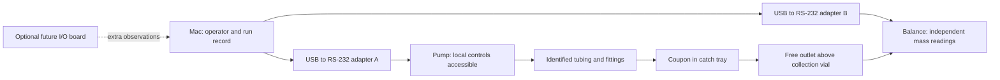

# Water bench hardware basis W1

Ticket T-21BC0885. Alex confirmed no pump, balance or controller is owned or
selected. This document proposes a reference architecture; it is not a purchase,
selected BOM, fabricated fixture or verified hardware system. Scope is water-only.
Primary manufacturer sources were checked on 2026-11-22 UTC.

## Proposed first lane

Use the Mac as the run coordinator, with separate USB-to-RS-232 connections to a
purchased syringe pump and balance. Keep the pump's local operator controls
accessible. This avoids making a custom motor driver and pump mechanics a
prerequisite for independently observing water delivery. A later custom pump
can use the same command/observation boundary after its own verification.

Preferred engineering reference: New Era NE-1000 plus A&D FX-120i-class balance.
Do not order yet: delivered pricing, availability, intended flow range, syringe,
fittings and coupon limits are unresolved. The balance manufacturer US page
currently marks FX-120i unavailable. Keep an equivalent documented serial balance
as an alternative; do not substitute one solely because it displays milligrams.

| Item | Reference facts | Design decision |
| --- | --- | --- |
| NE-1000 | Manufacturer lists $825 USD before shipping, local keypad, included 12 V supply, serial computer control and stall detection [P1, P2] | First-lane reference, because both local control and documented host control exist; budget remains unapproved |
| NE-501 OEM | Manufacturer lists $575, no built-in user interface; NE-500 at $520 lacks the NE-501 stall option; supply and cables add cost [P3] | Integration alternative; compare complete cost and operator controls, not bare pump price |
| Historical custom pump | Axis/rod-clearance problems are recorded in the pump review | Separate redesign track; do not print the frozen source as a working replacement |
| A&D FX-120i | 122 g capacity, 0.001 g readability, 0.001 g listed repeatability, standard RS-232 [B1, B2] | Performance reference; availability and total acquisition cost need confirmation |
| A&D EJ-123 / EJ-303 | 120 / 310 g capacity, 0.001 g readability, 0.003 g repeatability; EJ-03 adds RS-232 [B3, B4] | Quote alternative; lower capacity model is not inherently more precise |
| Controller board | UNO R4 Minima is a documented 5 V development board [C1] | Optional future sensor/indicator I/O. Neither required for this serial first lane nor a substitute for a reviewed hardware stop |

EJ-02 Quick USB sends numerical values one way; the manual says it is not a
bidirectional interface. Specify EJ-03 if using the proposed query/readback
architecture. Use proper RS-232 adapters, not TTL UART cables or direct board
GPIO. Verify each pinout, cable direction, macOS driver and physical connector
against the delivered devices. Do not infer serial compatibility from an RJ or
USB connector's shape. No serial driver has been implemented or exercised here.

## Electrical and software boundaries

The pump and balance retain their specified external power supplies. The Mac
records independent device observations; a future I/O board does not power a
pump motor or connect directly to RS-232 voltage levels. Keep connectors and
power devices outside the observed wet envelope. Neither this layout nor a
plain FX-i model establishes an ingress rating.

Connection path:

The A&D FX manual documents query, continuous-read, cancellation and identity
commands. Preserve its raw status/unit fields alongside parsed mass and host
monotonic receipt times. A display refresh frequency is not a verified host
sample rate. Read model/serial identity before associating readings with a run.
Do not issue remote tare/calibration implicitly on connect or reconnect.

For the pump, inspect actual firmware and configured power-failure behavior,
serial settings and stop handling before any start command. The historical
protocol manual is not evidence of the delivered firmware state. Reconnect
must perform identity/state reconciliation and require deliberate re-arming.
No automatic resume or automatic communication retry of a start command.
A software STOP acknowledgment does not prove stopped motion or relieved fluid
pressure. Stop/limit design and physical observation remain separate work.

## Measurement budget before selecting flow

No operating flow range has been chosen. The table below is a sizing calculation,
not a run recipe or an acceptance criterion. It assumes water density exactly
1 mg/µL solely for arithmetic; real conversion needs temperature/density data.

| Illustrative rate | Approximate mass increase | Time per 1 mg display count | Time to collect 100 mg |
| --- | --- | --- | --- |
| 1 µL/min | 1 mg/min | 60 s | 100 min |
| 10 µL/min | 10 mg/min | 6 s | 10 min |
| 100 µL/min | 100 mg/min | 0.6 s | 1 min |

A 1 mg display step does not mean 1 mg accuracy. A before/after difference can
contain two rounding contributions, plus repeatability, drift, evaporation,
vibration, drafts and timing error. Collecting 100 display counts does not
establish 1% total uncertainty. Very low-flow work may require longer intervals,
a more sensitive balance or another measurement method. The required range and
uncertainty must drive that choice, not the pump's minimum advertised setting.
Gross vial + nest + liquid must stay below the balance capacity with margin;
taring does not recover physical capacity. Weigh the actual printed nest and vial.

## CAD consequences already established

The generic receiver is not a commercial-balance fit. It assumes 120×120 mm body,
100×100 mm pan and pan height 40 mm. Its validated input range permits a maximum
200 mm body side and 80 mm pan height, and limits the frame span to 230 mm.

The FX-family drawing shows a 193×262.5 mm footprint, Ø130 pan, off-center pan
and a separate breeze-break envelope [B2, printed page 75]. Therefore it cannot
be fitted by just editing the existing generic TOML: it needs separate body/pan
origins and keepouts, larger or separate supports, rear cable space, front-key
access and draft-shield access. The frame must not bridge loads into the pan.
The drawing and regional product dimensions are not fully consistent in height;
confirm the exact delivered variant/drawing before assigning a mating height.
No manufacturer outline was inferred from a product photograph.

Next receiver revision should use an independent bench-mounted support with
adjustable outlet position, separate from the balance body. Prefer split
supports or stock extrusion over enlarging a single integral printed frame.
Account for the existing draft shield, its opening and tube access without
modifying the instrument. Keep the current generic candidate as a concept.

The generic controller carrier uses a rectangular 64×34 mm hole pitch; that is
not a measured UNO mounting pattern. Preserve it as a generic carrier until a
board is actually needed and its controlled CAD/connector envelopes are reviewed.

## Procurement and integration checklist

1. Fix intended water-only flow range, measurement uncertainty and run duration.
2. Obtain current delivered quotes for the two pump/balance routes, appropriate
   regional supplies, serial cables/adapters and calibration mass. No purchases
   or vendor messages are authorized by this design note.
3. Identify syringe make/model and ID from controlled data; select exact tubing
   ID/OD, compatible end fittings and documented working limits. A 2 mm coupon
   review port is not a matched commercial fitting interface.
4. Confirm exact instrument drawings, pan center/height, draft-shield openings,
   rear connector space and operator access. Update dry supports around them.
5. Observe real serial identity and raw balance frames; record stable/unstable,
   overload and units. No synthetic frames establish this checkpoint.
6. Review and observe stop, fault and reconnect behavior on the real pump.
7. Independently observe water delivery and preserve raw readings and failures.

## Primary sources

- [P1: NE-1000 manufacturer product page](https://www.syringepump.com/NE-1000.php)
- [P2: NE-1000 manufacturer manual, firmware V3.923](https://www.syringepump.com/download/NE-1000%20Syringe%20Pump%20User%20Manual.pdf)
- [P3: OEM NE-500/501 manufacturer page](https://www.syringepump.com/oem.php)
- [B1: A&D FX-120i manufacturer US page](https://weighing.andonline.com/product/fzfx-series-precision-balances-fx-120i/)
- [B2: A&D FZ-i / FX-i manual](https://www.aandd.jp/products/manual/balances/fz_fx-i.pdf)
- [B3: A&D EJ 1 mg manufacturer page](https://www.aandd.jp/products/weighing/balance/compact/ej_1mg.html)
- [B4: A&D EJ-123/303 manual](https://www.aandd.jp/products/manual/balances/ej1mg_manual.pdf)
- [C1: Arduino UNO R4 Minima documentation](https://docs.arduino.cc/hardware/uno-r4-minima)
